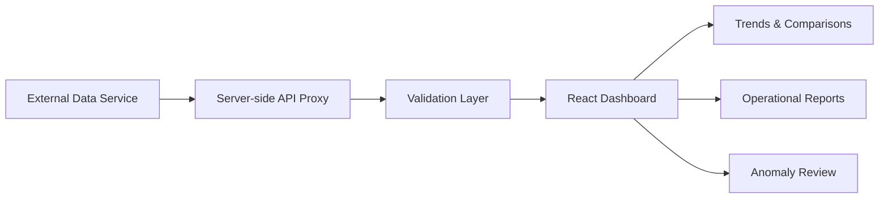

# Energy & Water Monitoring Dashboard — Case Study

> Public, sanitized case study. Operational credentials, external API keys, private source code, and business data remain private.

## Context

Raw electricity and water data is difficult to act on without validation, comparison, trend analysis, and clear reporting.

## Objective

Transform device data into operational views that help users compare periods, detect anomalies, and prepare reports.

## Architecture

## Scope

- Electricity and water consumption analysis
- Device and period comparisons
- Dataset validation
- Anomaly-oriented checks
- Dashboard visualization
- Operational reporting
- Server-side handling of external API credentials

## Security Improvement

The integration is designed so production API credentials remain server-side and are not exposed through client-side environment variables or public repositories.

## Technology

React · TypeScript · Vite · Recharts · Express · Vitest · Playwright

## What This Demonstrates

**data validation · operational analytics · secure integration design · reporting · QA · dashboard design**
